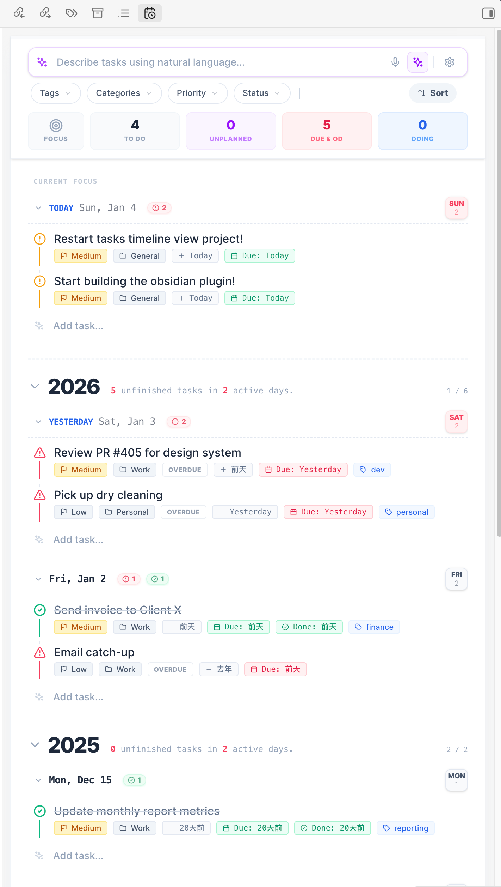

# Tasks Timeline



Tasks Timeline shows and manages task items in an Obsidian vault. It is a continuation of [obsidian-tasks-calendar-wrapper](https://github.com/Leonezz/obsidian-tasks-calendar-wrapper),
based on [tasks-timeline-components](https://github.com/Leonezz/tasks-timeline-components).

## Task lines

Tasks are read from and written to [Obsidian Tasks](https://publish.obsidian.md/tasks/) lines in your notes. Saving a task changes only what you changed: the rest of the line stays as written.

- **Fields**: 🛫 start, ⏳ scheduled, 📅 due, ✅ done, ❌ cancelled and ➕ created dates, priorities, 🔁 recurrence, 🏁 on-completion, 🆔 id and ⛔ depends-on.
- **Recurrence** is saved as Obsidian Tasks text (`🔁 every week on Monday`), from the task editor, the in-app agent and MCP clients alike. A `🔁` that runs straight into other text (`🔁 every day at 9:30`) is part of the title, not a rule. MCP clients can't set a rule with a number of repetitions (`COUNT`): each completion would count again, so the rule would never end. Use an end date instead.
- **Titles are one line.** A title with a line break, including the Unicode line and paragraph separators (U+2028, U+2029), is refused with an error instead of being written as extra lines. Only an AI client can send one.
- **Typing fields into a new task's title** works: adding `Pay rent 📅 2026-10-20 ⏫` creates the task with that due date and priority.
- **Dataview inline fields** (`[[due:: 2026-10-25]]`) are read in the title and after the fields, and stay on the line. Their dates are the task's dates: changing the due date rewrites `[[due:: …]]`, and clearing it removes the field.
- **Reminders** (`⏰ 2026-10-16 09:00` and obsidian-reminder's `(@2026-10-16 09:00)`) stay on the line, out of the title.
- **Notes and links after the fields** (`… 📅 2026-10-16 see [[Draft notes]]`) stay where they are, and the next occurrence of a recurring task keeps them.

### Rules split over two lines by version 0.3.0 and earlier

Plugin versions up to 0.3.0 wrote a recurrence rule with a start date over two lines:

```markdown
- [ ] Report 📅 2026-10-16 🔁 DTSTART:20261015T160000Z
RRULE:FREQ=WEEKLY;INTERVAL=1
```

Such a task is shown with the rule it stands for (`every week on Friday`), and the next time you save it (edit, complete, or change it through MCP) the line is repaired: the rule is written as Obsidian Tasks text with its day made explicit, and the `RRULE:` line is removed. A task without any date also gets the rule's start date as 🛫. Saving a task without changes leaves the note alone.

Version 0.3.0 and earlier also misread such a task: saving it again (ticking or renaming it) moved the start date into the title and left `🔁 DTSTART` after the fields, with the `RRULE:` line still below:

```markdown
- [x] Report  :20261015T160000Z 📅 2026-10-16 ✅ 2026-10-17 🔁 DTSTART
RRULE:FREQ=WEEKLY;INTERVAL=1
```

That task is repaired the same way, and the start date is taken out of the title. A priority those versions wrote before the start date (`- [x] Report ⏫  :20261015T160000Z 📅 …`) is read as the task's priority, as are other fields there, and stays on the repaired line.

If Obsidian has indexed the task without its `RRULE:` line, completing it through MCP fails with the exact rule to write by hand; editing the task once repairs the line instead.

A rule that can't be written as text with the same dates is refused with an error, and the note is left as it is: rules with `COUNT`, a task date before the rule's start or out of step with its interval, hourly rules, or a `🔁 DTSTART` whose start date is gone from the line. Repair those by hand: delete the `RRULE:` line, remove a start date left in the title (`:20261015T160000Z`), and replace `🔁 DTSTART…` with the rule as text, such as `🔁 every week`. A copy of such a task with `🔁 DTSTART` and no `RRULE:` line below has lost its rule altogether; completing it fails with an error until you write the rule by hand.

## AI and voice input

- AI provider requests and **Test Connection** go through Obsidian's `requestUrl`, so providers that don't allow browser CORS work. Requests can't be cancelled, and responses arrive whole rather than streamed.
- Voice input: Obsidian's built-in browser speech recognition doesn't work, so the **Browser** voice provider is shown as unavailable. Choose **OpenAI** or **Gemini** in **Settings > Tasks Timeline > AI**.

## MCP server

The plugin includes a built-in [Model Context Protocol (MCP)](https://modelcontextprotocol.io/) server that lets AI agents read and write tasks in your vault.

### Setup

1. Open **Settings > Tasks Timeline > MCP server**
2. Toggle **Enable MCP server** on
3. The server starts on `http://127.0.0.1:27182/mcp` (port is configurable)

### Connecting AI clients

Add the following to your MCP client configuration (e.g. Claude Desktop, Claude Code, Cursor):

```json
{
  "mcpServers": {
    "tasks-timeline": {
      "url": "http://127.0.0.1:27182/mcp"
    }
  }
}
```

Task ids look like `Projects/WebApp.md:12:0~<version>`: the version binds an id to the task line it was issued for. Once the line changes, the id is refused ("changed since it was read") and the client should query the tasks again.

Bearer-token auth is enabled by default. Copy the token from **Settings > Tasks Timeline > MCP server** and configure it as an `Authorization: Bearer <token>` header in clients that support HTTP MCP headers.

### Available Tools

| Tool | Description |
|------|-------------|
| `query_tasks` | Search and filter tasks by status, category, tags, date range, and free-text |
| `create_task` | Create a new task with title, priority, dates, tags, and recurrence |
| `update_task` | Update an existing task by ID (partial updates supported) |
| `delete_task` | Delete a task by ID |
| `complete_task` | Mark a task as done (handles recurring tasks) |
| `cancel_task` | Cancel a task or recurring series |
| `batch_update_tasks` | Update multiple tasks matching a filter |
| `get_task_stats` | Get aggregate statistics (counts by status, priority, category) |
| `get_today_plan` | Get tasks due today and overdue tasks sorted by priority |

### Available Resources

| Resource | URI | Description |
|----------|-----|-------------|
| All Tasks | `tasks://all` | List of all tasks |
| Task by ID | `tasks://task` | Retrieve a single task |
| Overdue | `tasks://overdue` | Tasks that are past due |
| Today | `tasks://today` | Tasks due or starting today |
| Upcoming | `tasks://upcoming` | Tasks due in the next 7 days |
| Stats | `tasks://stats` | Aggregate task statistics |

### Available Prompts

| Prompt | Description |
|--------|-------------|
| `plan_my_day` | Review today's tasks and create a prioritized daily plan |
| `weekly_review` | Review task progress and suggest priorities for next week |
| `task_triage` | Identify stale tasks and suggest actions |
| `obsidian_task_guide` | Reference for Obsidian task syntax and conventions in this vault |
| `project_review` | Review tasks grouped by file or folder |
| `daily_note_tasks` | Plan a day from daily notes, tasks due that day and overdue tasks |
| `tag_workflow_review` | Review the tasks with a tag, grouped by status |
